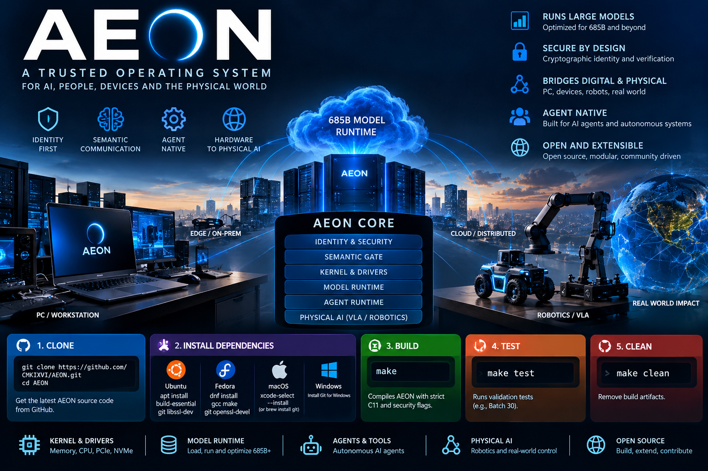

<p align="center">
  
</p>

# AEON — Autonomous Engine, Orchestrator & Node

AEON is a native AI runtime/OS foundation being developed in C for autonomous execution, model runtime, compute, storage, networking, hardware control, robotics and secure AI I/O.

## Current status

**Batch 32 — 74% production readiness**

Batch 32 adds a deterministic semantic wire codec with explicit versioning, bounds checks and big-endian integer encoding. It also hardens the process-gate ABI by removing the unsafe cast between the ioctl payload and the internal submit ABI.

The 74% figure is an engineering readiness estimate for the implemented scope, not a claim that AEON is a finished production operating system. Physical kernel/eBPF/netfilter attachment, hardware network interception and other hardware-level validation remain future work.

## Build and test

```bash
make clean
make test
```

Strict baseline:

```text
-std=c11 -Wall -Wextra -Wpedantic -Werror -O2
```

Expected results:

```text
AEON Batch 31 authenticated semantic transmission test: PASS
AEON Batch 32 semantic wire codec test: PASS
```

## Architecture

```text
AEON
├── Cognitive Engine
├── Model Runtime
├── Compute Engine
├── Storage Engine
├── System / UEFI / Kernel
├── Network
├── Interface / Widgets
├── Tool Bus
└── Robotics / Embodied / VLA
```

Security work includes self-sovereign identity, semantic S-P-O transmission gates, cryptographic verification and Proof-of-Friction policy boundaries.

## Repository layout

- `core/` — AEON runtime/security foundations
- `drivers/` — hardware and NVMe foundations
- `kernel/` — kernel-facing boundaries
- `include/` — public C interfaces
- `tests/` — strict host-testable validation
- `docs/` — engineering scope and readiness records

## Important boundary

Host-testable code is deliberately distinguished from claims of a bootable/hardware-validated OS. A component is not considered hardware-complete until it has been validated against its real execution environment.

## Roadmap

Next engineering stages continue from semantic wire transport toward native kernel I/O enforcement, hardware network interception, model runtime, cognitive execution and robotics/embodied AI integration.
